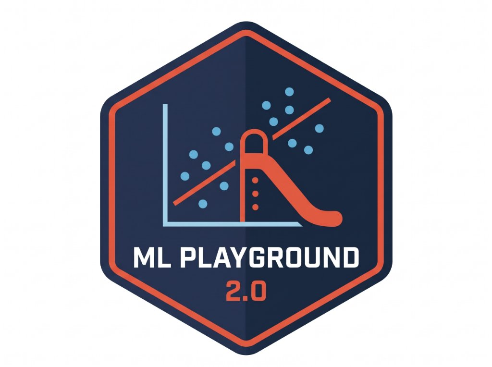

<p align="center">
  
</p>

# Machine Learning Playground 2.0
### An Interactive Visual Sandbox for Learning Analytics and Educational Data Mining

🌐 **Live Web Application:** [https://taridwong.github.io/ml-playground-2.0/](https://taridwong.github.io/ml-playground-2.0/)

Developed by **Jo Chuang**; Extended and modernized by **Tarid Wongvorachan**.

Connect with the Maintainer: For inquiries, updates, or collaboration regarding ML Playground 2.0, connect with [Tarid Wongvorachan](https://sites.google.com/view/tarid2/).

---

## Overview

**Machine Learning Playground 2.0** is an interactive, browser-based sandbox designed for students, educators, and researchers in **Learning Analytics (LA)** and **Educational Data Mining (EDM)**.

Originally created as an intuitive visualization of basic machine learning classifiers, Version 2.0 has been redesigned and modernized to aid educators in their learning of machine learning algorithms.

Students and educators can plot student data points, observe how 10 machine learning algorithms make decision boundaries, inspect real-time risk probabilities, and evaluate the policy impact of false alarms versus missed students.

---

## What Is New in Version 2.0

### 1. Expanded to 10 Machine Learning Paradigms
* **K-Nearest Neighbors (KNN):** Interactive neighborhood consensus with live slider updates and uniform versus inverse-distance voting.
* **Logistic Regression:** Continuous probabilistic sigmoidal surfaces with an adjustable intervention threshold and degree 1 (linear) or degree 2 (polynomial) feature expansion.
* **Gaussian Naive Bayes:** Probabilistic cloud modeling using Bayes theorem with empirical school base rates and variance smoothing.
* **Perceptron:** The classic single straight-line separating hyperplane trained through incremental mistake correction.
* **Support Vector Machine (SVM):** Maximum-margin road optimization with support vector identification and Linear, Polynomial, and Radial Basis Function (RBF) kernels.
* **Decision Tree:** Step-by-step orthogonal rule cuts using Gini Impurity (CART) or Shannon Entropy (C4.5) splitting criteria.
* **Random Forest:** Ensemble bagging committee that aggregates multiple decision trees to produce smooth consensus probability gradients that resist classroom noise.
* **Extreme Gradient Boosting (XGBoost):** Sequential boosting ensemble that trains small decision trees to predict residuals, demonstrating how shrinkage and boosting rounds control overfitting.
* **Association Rules (CBA):** Classification Based on Associations that discretizes continuous scores into rubric performance bands (e.g. Low, Medium, High) and mines transparent if-then decision rules.
* **Artificial Neural Network (ANN):** Multi-layer perceptron with an interactive visual architecture builder (add or remove hidden layers and neurons) and real-time backpropagation.

### 2. Learning Analytics & Evaluation Dashboard
* **Real-Time Student Inspector:** Hover anywhere across the canvas to inspect continuous risk probabilities and identify misclassified students.
* **Standard LA Metrics:** Computes Sensitivity (Recall), Specificity (True Negative Rate), Precision (Positive Predictive Value), F1 Score, and Accuracy.
* **2x2 Confusion Matrix:** Displays True Positives (caught for intervention), False Negatives (missed students), False Positives (false alarms), and True Negatives (thriving students).
* **Empirical ROC Curve & AUC:** Computes the Receiver Operating Characteristic curve across decision thresholds and grades model discrimination.

### 3. Educational Policy & Cost-Benefit Planner
* Connects classification errors directly to school resources:
  * **False Alarm Burden:** Calculates wasted teacher outreach time or counseling budget.
  * **Missed Student Deficit:** Quantifies compounding remediation hours or summer school costs.
* Allows administrators to toggle between teacher time (hours) and remediation funding ($).

### 4. Model Comparison Benchmark
* Evaluates all 10 algorithms simultaneously on your active student cohort.
* Ranks models by F1 score and Accuracy to demonstrate that the best algorithm depends on the geometric shape of student behaviors.

### 5. Curated Educational Data Patterns
* **Higher Ed Early Warning Dropout:** Linear separable student cohort based on engagement, class attendance, and assignment completion.
* **K-12 Formative Assessment Mastery:** L-shaped rule-based relationship where passing can occur through high diagnostic scores or high practice volume.
* **EDM Classic (Gaming the System):** Non-linear enclosed island based on rapid guessing and hint abuse.

### 6. Modernized Log
* Fully upgraded from legacy React 15 and Webpack 2 to modern **React 18** and **Vite 6**.
* Professional educational theme featuring navy slate, teal (On-Track), and rose (At-Risk).
* 100% client-side execution in the browser with zero server setup required.

---

## Live Demo & Public Access

You can use the application directly in any modern desktop or tablet web browser:

👉 **[Launch Machine Learning Playground 2.0](https://taridwong.github.io/ml-playground-2.0/)**

No account, download, or installation is needed.

---

## Running Locally

To run the project on your own machine:

### Prerequisites
* [Node.js](https://nodejs.org/) (version 18 or higher recommended)
* npm (bundled with Node.js)

### Installation Steps

1. Clone the repository:
```bash
git clone https://github.com/TaridWong/ml-playground-2.0.git
cd ml-playground-2.0
```

2. Install dependencies:
```bash
npm install
```

3. Start the local development server:
```bash
npm run dev
```
Open your browser and navigate to `http://localhost:3000/`.

4. Build for production:
```bash
npm run build
```
The compiled, optimized files will be output to the `dist/` directory.

---

## Deployment to GitHub Pages

This repository includes an automated GitHub Actions deployment workflow at `.github/workflows/deploy.yml`.

To deploy your own fork:
1. Push your repository to GitHub.
2. In your repository on GitHub, navigate to **Settings** > **Pages**.
3. Under **Build and deployment** > **Source**, select **GitHub Actions**.
4. GitHub will automatically build and publish your web app.

---

## Authors & Acknowledgments

* **Original ML Playground:** Conceived and built by [Jo Chuang](https://github.com/josephch405) ([mldemos](https://github.com/josephch405/mldemos)).
* **Version 2.0 Architecture & LA/EDM Extensions:** Designed and developed by [Tarid Wongvorachan](https://github.com/TaridWong) ([Website](https://sites.google.com/view/tarid2/)).

---

## Citation

If you use Machine Learning Playground 2.0 in your research, teaching, curriculum, or publications, please cite it as:

```bibtex
@software{wongvorachan2026mlplayground2,
  author = {Wongvorachan, Tarid},
  title = {Machine Learning Playground 2.0 for Learning Analytics & Educational Data Mining},
  year = {2026},
  url = {https://github.com/TaridWong/ml-playground-2.0}
}
```

---

## License

This project is licensed under the [MIT License](https://opensource.org/license/mit) - see the [LICENSE](LICENSE) file for full details.
Original work copyright (c) 2017 Jo Chuang. Version 2.0 enhancements and extensions copyright (c) 2026 Tarid Wongvorachan.
