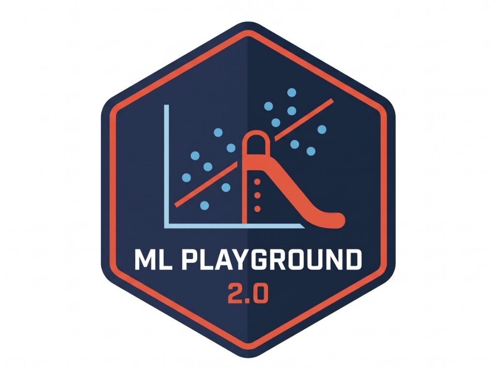

<p align="center">
  
</p>

# Machine Learning Playground 2.0
### Interactive Classification Playground for Learning Analytics and Educational Data Mining

**Live Web Application:** [https://taridwong.github.io/ml-playground-2.0/](https://taridwong.github.io/ml-playground-2.0/)

Developed by **Jo Chuang**; extended and updated by **Tarid Wongvorachan**.

For inquiries, updates, or collaboration regarding ML Playground 2.0, contact [Tarid Wongvorachan](https://sites.google.com/view/tarid2/).

---

## Overview

**Machine Learning Playground 2.0** is a browser-based interactive tool for students, educators, and researchers in **Learning Analytics (LA)** and **Educational Data Mining (EDM)**.

Originally created as a visualization tool for basic classifiers, Version 2.0 adds educational datasets, model inspection panels, counterfactual analysis, and evaluation metrics for classroom teaching and self-study.

Users can plot data points on a 2D canvas, inspect how 10 classification algorithms form decision boundaries, examine point-level risk estimates, and compare the resource trade-offs of false alarms versus missed At-Risk students.

---

## Features in Version 2.0

### 1. Ten Classification Algorithms
* **K-Nearest Neighbors (KNN):** Instance-based classification using uniform or inverse-distance neighbor voting.
* **Logistic Regression:** Linear and degree-2 polynomial log-odds models with an adjustable decision threshold and L2 regularization.
* **Gaussian Naive Bayes:** Generative classifier using class prior base rates, per-class feature means and variances, and variance smoothing.
* **Perceptron:** Linear threshold classifier trained through sequential updates on misclassified points.
* **Support Vector Machine (SVM):** Maximum-margin classifier with support vector inspection and Linear, Polynomial, and Radial Basis Function (RBF) kernels.
* **Decision Tree:** Axis-aligned recursive partitioning using Gini Impurity (CART) or Shannon Entropy (C4.5), paired with a tree structure viewer.
* **Random Forest:** Bootstrap aggregating ensemble that averages predictions across multiple decision trees.
* **Extreme Gradient Boosting (XGBoost):** Sequential additive tree ensemble fitted to binary cross-entropy residuals with learning rate shrinkage.
* **Association Rules (CBA):** Classification Based on Associations that bins continuous axes into ordinal intervals and extracts IF-THEN rules filtered by support and confidence.
* **Artificial Neural Network (ANN):** Multi-layer perceptron with configurable hidden layers, neuron counts, learning rate, and epochs.

### 2. Model Inspection & Counterfactual Analysis
* **Cursor Probe:** Hover over the canvas to inspect predicted class, risk probability, and actual versus predicted match status.
* **Model Parameter Inspector:** Displays learned feature weights, support vectors, Gaussian class distributions, tree split proportions, or discovered CBA rules depending on the active algorithm.
* **Counterfactual Boundary Analysis:** Computes minimum feature adjustments needed to move a selected student across the decision boundary, with interactive sliders to test hypothetical score changes.
* **High-Resolution Plot Export:** Exports a 2x resolution PNG combining the boundary heatmap or solid plot, data points, axis labels, and dataset metadata.

### 3. Learning Analytics Metrics & Policy Planner
* **Classification Metrics:** Computes Accuracy, Sensitivity (Recall), Specificity, Precision, and F1 Score.
* **2x2 Confusion Matrix:** Displays True Positives (caught for support), False Negatives (missed At-Risk), False Positives (false alarms), and True Negatives (correctly unflagged).
* **Empirical ROC Curve & AUC:** Plots the Receiver Operating Characteristic curve across decision thresholds and reports Area Under the Curve (AUC).
* **Educational Resource & Policy Impact Planner:** Maps false positives and false negatives to teacher outreach hours or remediation funding ($).

### 4. Model Comparison
* Evaluates all 10 classifiers on the active cohort in memory.
* Ranks models by F1 score and Accuracy so users can compare how different decision boundaries behave on the same data.

### 5. Educational Data Presets
* **Higher Ed Retention:** Linearly separable cohort based on LMS engagement, attendance, and assignment completion.
* **K-12 Formative Mastery:** L-shaped rule pattern where students pass via high diagnostic scores or high practice volume.
* **Gaming the System (EDM):** Enclosed non-linear cluster representing rapid guessing and hint abuse surrounded by typical learners.

### 6. Technical Stack
* Upgraded from legacy React 15 and Webpack 2 to **React 18** and **Vite 6**.
* Color palette built around slate, teal (`On-Track`), and rose (`At-Risk`).
* Runs client-side in the browser with no backend server required.

---

## Live Access

The application runs in desktop and tablet browsers:

**[Launch Machine Learning Playground 2.0](https://taridwong.github.io/ml-playground-2.0/)**

No account, download, or installation is required.

---

## Running Locally

### Prerequisites
* [Node.js](https://nodejs.org/) (version 18 or higher recommended)
* npm (bundled with Node.js)

### Installation Steps

1. Clone the repository:
```bash
git clone https://github.com/TaridWong/ml-playground-2.0.git
cd ml-playground-2.0
```

2. Install dependencies:
```bash
npm install
```

3. Start the local development server:
```bash
npm run dev
```
Open your browser and navigate to `http://localhost:3000/`.

4. Build for production:
```bash
npm run build
```
Compiled output is written to the `dist/` directory.

---

## Deployment to GitHub Pages

This repository includes a GitHub Actions deployment workflow at `.github/workflows/deploy.yml`.

To deploy your own fork:
1. Push the repository to GitHub.
2. In your GitHub repository, open **Settings** > **Pages**.
3. Under **Build and deployment** > **Source**, select **GitHub Actions**.
4. GitHub Actions builds and publishes the web application on push.

---

## Authors & Acknowledgments

* **Original ML Playground:** Conceived and built by [Jo Chuang](https://github.com/josephch405) ([mldemos](https://github.com/josephch405/mldemos)).
* **Version 2.0 Architecture & LA/EDM Extensions:** Designed and developed by [Tarid Wongvorachan](https://github.com/TaridWong) ([Website](https://sites.google.com/view/tarid2/)).

---

## Citation

If you use Machine Learning Playground 2.0 in your research, teaching, curriculum, or publications, please cite it as:

```bibtex
@software{wongvorachan2026mlplayground2,
  author = {Wongvorachan, Tarid},
  title = {Machine Learning Playground 2.0 for Learning Analytics & Educational Data Mining},
  year = {2026},
  url = {https://github.com/TaridWong/ml-playground-2.0}
}
```

---

## License

This project is licensed under the [MIT License](https://opensource.org/license/mit); see the [LICENSE](LICENSE) file for details.
Original work copyright (c) 2017 Jo Chuang. Version 2.0 enhancements and extensions copyright (c) 2026 Tarid Wongvorachan.
